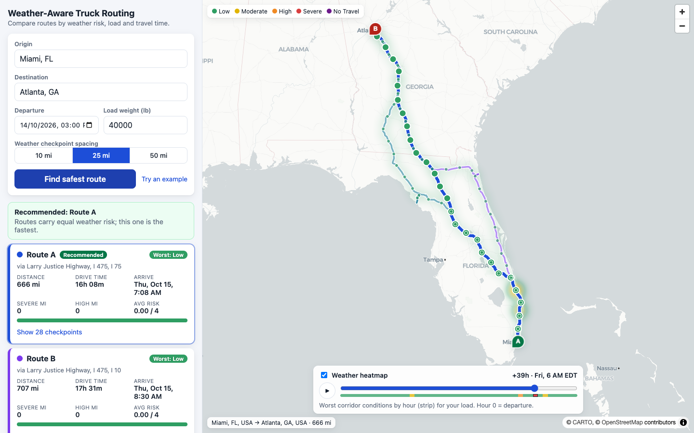

# Weather-Aware Truck Routing

Pick an origin, destination, departure time and load weight. The app generates **three route options**, forecasts the weather at **the time the truck will actually reach each checkpoint**, scores the risk with the load-aware rules, and **recommends the safest route** that balances weather risk against travel time. Everything is shown on a map, with a **0–48 h weather heatmap** you can scrub.



**Live demo:** _add the Vercel URL after deploying (see [Deployment](#deployment))_ · **API docs:** `/api/docs/` · **Walkthrough:** _add the Loom link_

## Requirements → where they live

| Requirement | Implementation |
|---|---|
| Origin, destination, departure, load weight | [TripForm](frontend/src/features/trip-form/TripForm.tsx) with ORS autocomplete |
| 3 route options from a routing API | [`routing/alternatives.py`](backend/apps/routing/alternatives.py) (OpenRouteService, HGV profile) |
| Weather every 10 / 25 / 50 mi at **ETA** | [`routing/sampling.py`](backend/apps/routing/sampling.py) + [`trips/services.py`](backend/apps/trips/services.py) |
| Risk rules + load rules | [`risk/rules.py`](backend/apps/risk/rules.py) — see [docs/RISK_RULES.md](docs/RISK_RULES.md) |
| Recommendation (Severe → High → avg → time) | [`risk/ranking.py`](backend/apps/risk/ranking.py) |
| Routes, checkpoints, risk, ETAs, summaries on a map | [MapView](frontend/src/features/map/MapView.tsx), [RouteCard](frontend/src/features/routes/RouteCard.tsx) |
| Heatmap with 0–48 h slider | [HeatmapControls](frontend/src/features/heatmap/HeatmapControls.tsx) |

## Quick start

You need an [OpenRouteService API key](https://openrouteservice.org/dev/#/signup) (free). Weather comes from [Open-Meteo](https://open-meteo.com/) and needs no key.

```bash
cp .env.example .env          # then set ORS_API_KEY
make up                       # builds and runs everything → http://localhost:8080
```

Local development without Docker:

```bash
make backend-install frontend-install
make backend                  # Django on :8000
make frontend                 # Vite on :5173 (proxies /api to :8000)
make test lint                # 91 backend + 12 frontend tests, ruff, eslint, tsc
```

Requires Python 3.12+ and Node 18.18+ (Node 20 in Docker/CI).

### Configuration

| Variable | Purpose | Default |
|---|---|---|
| `ORS_API_KEY` | OpenRouteService key | _required_ |
| `DJANGO_SECRET_KEY` | Django secret | required when `DJANGO_DEBUG=false` |
| `DJANGO_DEBUG` | Debug mode | `false` |
| `DJANGO_ALLOWED_HOSTS` | Comma-separated hosts | `localhost,127.0.0.1` |
| `CORS_ALLOWED_ORIGINS` | Allowed frontend origins | `http://localhost:5173` |
| `VITE_API_URL` | API base URL for the frontend build (split hosting) | empty (same origin) |

## API

`POST /api/trips/analyze/`

```json
{
  "origin": { "label": "Chicago, IL" },
  "destination": { "label": "Denver, CO", "lat": 39.74, "lon": -104.99 },
  "departure": "2026-10-14T15:00:00Z",
  "load_lb": 42000,
  "interval_mi": 25
}
```

Returns `routes[]` (geometry, distance, duration, arrival, rank, risk metrics, `checkpoints[]` with ETA, weather and risk), a `recommendation` with a plain-language reason, and a `heatmap` (48 hourly risk levels for ~100 corridor points). `GET /api/geocode/autocomplete/?q=` powers the place search. Errors share one shape: `{"error": {"code", "message", "details?"}}`. Interactive docs: `/api/docs/` (Swagger) and `/api/redoc/`.

## How it works

1. **Routes.** ORS only supports native alternatives for trips under ~100 km, so short trips use them, and longer trips route through via-points offset perpendicular to the trip on either side. Candidates are kept only if they follow a genuinely different corridor (overlap filter) and aren't absurd detours (≤1.6× distance).
2. **ETA sampling.** Checkpoints are placed every 10/25/50 mi. Elapsed time is interpolated from per-maneuver durations (so slow urban legs and fast highway legs are respected), and the forecast hour nearest `departure + elapsed` is used.
3. **Risk.** Each checkpoint takes the worst of wind/rain/snow, then load rules escalate wind risk. Each checkpoint "owns" half the gap to its neighbours, giving miles per risk level.
4. **Recommendation.** Strict order: No Travel miles → Severe miles → High miles → average risk → duration.
5. **Heatmap.** One batched weather fetch covers checkpoints and corridor points; all 48 hourly frames ship in one response so scrubbing the slider makes no requests.

Deeper detail: [docs/ARCHITECTURE.md](docs/ARCHITECTURE.md) · [docs/RISK_RULES.md](docs/RISK_RULES.md).

## Project layout

```
backend/apps/risk      pure domain logic (no Django): rules, metrics, ranking
backend/apps/routing   ORS client, route generation, geometry, checkpoint sampling
backend/apps/weather   Open-Meteo client, units, caching
backend/apps/trips     DRF views/serializers + orchestration service
frontend/src           features/{trip-form,routes,map,heatmap}, api, hooks, lib
```

## Assumptions and limitations

- Wind uses **sustained 10 m wind speed** (gusts are not scored). Rain is `rain + showers`; snow is forecast snowfall depth per hour (not water equivalent).
- Forecasts reach ~15 days; checkpoints beyond that are shown as **Unknown** and excluded from averages rather than assumed safe.
- Heatmap hour 0 is the departure hour, and heatmap levels are per-hour conditions for your load (not ETA-shifted).
- Where the rule table shares an edge (e.g. rain 0.25 in/hr) the more severe band wins — see [docs/RISK_RULES.md](docs/RISK_RULES.md).
- Truck restrictions use ORS's HGV profile and the load weight; bridge/hazmat data depends on OpenStreetMap coverage.
- Free-tier ORS limits (40 directions/min) apply; results are cached for 7 days.

## Deployment

**Backend (Render).** Create a Blueprint from this repo (`render.yaml`), then set `ORS_API_KEY` and `CORS_ALLOWED_ORIGINS` (your Vercel URL).

**Frontend (Vercel).** Import the repo, set the root directory to `frontend`, and set `VITE_API_URL` to the Render URL. `vercel.json` provides the SPA rewrite.

## Git workflow

Conventional Commits, one short-lived branch per feature merged with `--no-ff` so the history reads as a sequence of reviewable steps (`git log --oneline --graph`).
